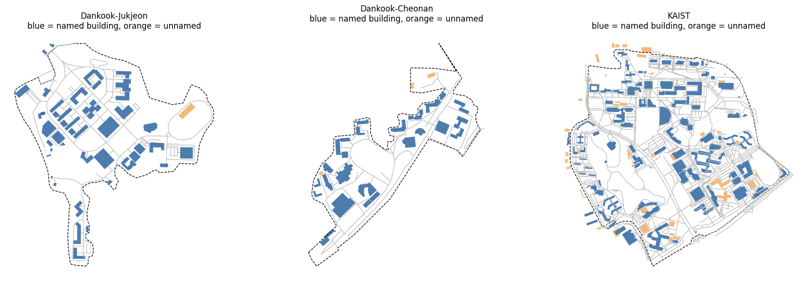
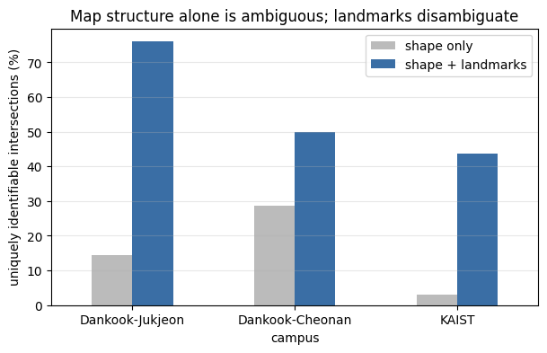

# OSM 캠퍼스 지도 분석

## 왜 했는지

공공 지도에는 위치를 구별할 단서가 얼마나 있을까?

복도나 건물 모양이 비슷해도 이름이 있으면 위치를 구별하는 데 도움이 될 것 같았다. 공공 지도에 그런 정보가 얼마나 들어 있는지 확인해 보고 싶었다.

## 한 것

- 단국대 죽전·천안·KAIST의 건물 이름, POI, 보행 네트워크를 수집했다.
- 보행 노드의 50 m 안에 이름 있는 대표점이 있는지 확인했다.
- 교차로 방향 간격으로 형태 서술자를 만들고 중복을 확인했다.
- 형태에 주변 이름 집합을 더한 서술자와 비교했다.

## 결과

| 캠퍼스 | 50 m 내 이름 있는 대표점이 없는 노드 (%) | 형태 서술자가 유일한 교차로 (%) | 형태+이름 서술자가 유일한 교차로 (%) |
|---|---:|---:|---:|
| 단국대 죽전 | 14.8 | 14.4 | 76.0 |
| 단국대 천안 | 67.2 | 28.6 | 50.0 |
| KAIST | 31.8 | 3.1 | 43.7 |

이름 정보를 더하면 서술자 중복이 줄었다.  
단, 반경 안의 이름을 모두 정확하게 읽는다고 가정했다.

파란색은 이름이 있는 건물, 주황색은 이름이 없는 건물로 표시했다. 지도 데이터: © OpenStreetMap contributors.

형태만 썼을 때와 이름을 더했을 때 유일한 서술자를 갖는 교차로 비율을 비교했다.

## 한계

- 검색 경계가 캠퍼스 전체인지 확인하지 못했다.
- 건물 대표점을 사용했으며, 실제 간판이나 출입구 위치는 반영하지 못했다.
- 가림·시야·이름 인식 실패는 반영하지 못했고, 실제 위치추정 정확도는 측정하지 않았다.
- 데이터 수집 날짜와 OSM 경계 ID는 기록하지 못했다.

## 실행

[노트북](notebooks/osm_campus_map_analysis.ipynb)은 Colab CPU에서 위에서부터 순서대로 실행했다.  
OSMnx 2.1.1을 사용했다. Nominatim/Overpass에 접근하려면 인터넷 연결이 필요했다.

## 출처

- 데이터: © [OpenStreetMap contributors](https://www.openstreetmap.org/copyright), ODbL.
- 분석 도구: [OSMnx](https://osmnx.readthedocs.io/).

코드 작성에 AI 도구를 보조로 활용했으며, 실험 설계와 결과 해석은 직접 수행했습니다.
