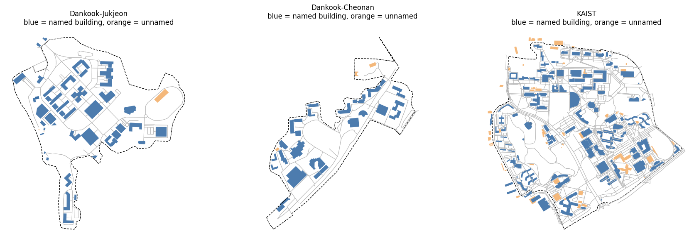
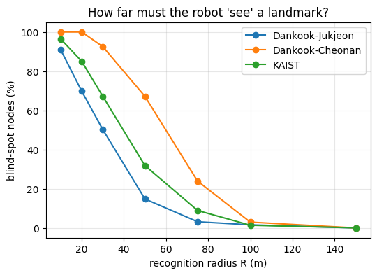
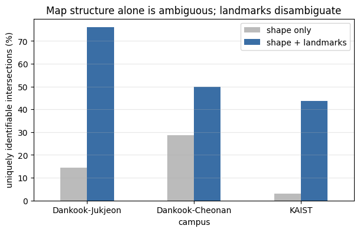

# OSM Campus Map Analysis
**공공 지도에는 위치를 구별할 단서가 얼마나 있을까?**

**Python · OSMnx · Spatial Analysis**

[노트북 보기](notebooks/osm_campus_map_analysis.ipynb) · [상세 결과](results/exploratory_results.md) · [실행 방법](#실행)

OpenStreetMap에 캠퍼스 위치를 구별할 단서가 얼마나 있는지 탐색한 Python 공간정보 분석 프로젝트입니다. 단국대 죽전·천안·KAIST의 건물 이름, POI, 보행 네트워크, 교차로 형태를 비교합니다.

**상태: 경계 검증 전 탐색 분석.** 로봇 위치추정 시스템이나 학습 모델이 아니며, 아래 비율은 실제 위치추정 정확도가 아닙니다. 지도 데이터의 특성과 분석 방법을 검토하는 독립 프로젝트입니다.

*파란색은 이름이 있는 건물, 주황색은 이름이 없는 건물입니다. 점선은 분석에 사용한 경계로, 전체 캠퍼스 경계의 정확성은 추가 확인이 필요합니다. 지도 데이터: © OpenStreetMap contributors.*

## 구현 내용
- OSMnx를 이용한 경계·건물·POI·보행 그래프 수집
- 미터 단위 투영 좌표계에서 랜드마크 대표점 거리 계산
- 보행 노드 기준 반경별 이름 정보 근접성 분석
- 교차로 방향 간격의 회전 불변 서술자와 중복 빈도 분석
- 교차로 형태에 주변 이름 집합을 추가한 서술자 비교
- 캠퍼스 지도 및 비교 그래프 시각화

## 주요 결과 — 원본 노트북 출력
| 캠퍼스 | 50m 내 이름 있는 대표점이 없는 노드 (%) | 형태 서술자가 유일한 교차로 (%) | 형태+이름 서술자가 유일한 교차로 (%) |
|---|---:|---:|---:|
| 단국대 죽전 | 14.8 | 14.4 | 76.0 |
| 단국대 천안 | 67.2 | 28.6 | 50.0 |
| KAIST | 31.8 | 3.1 | 43.7 |

선택한 지도와 표현에서는 이름 정보를 추가할 때 서술자 중복이 줄었습니다. 반경 내 이름을 전부 정확히 얻는다는 이상적 가정이므로 실제 센서 성능이나 로봇 위치추정 성공률로 해석하지 않습니다.

[실행 노트북 및 지도 그림](notebooks/osm_campus_map_analysis.ipynb) · [결과와 방법의 한계](results/exploratory_results.md)

## 결과를 그림으로 보기

### 01 · 주변 이름 정보가 없는 지점은 얼마나 될까?

검색 반경을 늘리면 이름 있는 대표점이 없는 보행 노드의 비율이 감소합니다. **50m 기준 죽전 14.8%, 천안 67.2%, KAIST 31.8%**입니다. 원본 그림의 'recognition radius'와 'blind-spot'은 지도상 거리 기준이며, 실제 카메라 인식 거리나 센서 사각지대를 측정한 값이 아닙니다.

### 02 · 형태에 이름 정보를 더하면 구별이 쉬워질까?

교차로 형태에 주변 이름 집합을 결합했을 때, 선택한 후보 집합에서 유일한 서술자를 갖는 교차로 비율이 증가했습니다. 죽전은 **14.4% → 76.0%**입니다. 이는 이름을 완전하고 정확하게 관측한다는 가정 아래의 **서술자 유일성**으로, 로봇 위치추정 정확도가 아닙니다.

그림의 출처와 나머지 분석 보기

그림 3개는 제공된 `osm_campus_localization (3).ipynb`의 저장된 PNG 출력에서 그대로 추출했습니다. 재실행하거나 수치를 새로 생성하지 않았습니다. 전체 4개 그림과 코드는 [노트북](notebooks/osm_campus_map_analysis.ipynb)에 있습니다.

## 실행
1. 위 노트북을 내려받아 Google Colab의 파일 업로드로 엽니다.
2. CPU 런타임에서 설치 셀부터 순서대로 실행합니다. GPU는 필요하지 않습니다.
3. CAMPUSES, LANDMARK_RADIUS, BUFFER를 확인합니다.
4. Nominatim/Overpass 인터넷 연결이 필요합니다. 요청 실패 시 잠시 뒤 재실행합니다.

OSMnx 2.1.1은 원본 실행 출력에서 확인한 버전입니다. 나머지 패키지의 원본 버전은 기록되지 않았습니다. pip 설치 셀은 OSMnx 2.1.1로 고정했지만 현재 환경에서 전체 다운로드·재실행 검증을 수행하지 않았습니다. 저장된 출력은 제공된 원본 실행의 결과입니다.

## 해석의 한계
- 검색 경계가 의도한 캠퍼스 전체인지 미확인입니다. 특히 천안 27.8ha 경계를 확인해야 합니다.
- 데이터 수집은 30m 버퍼를 포함하지만 밀도 분모는 원래 경계 면적입니다.
- 평가 지점은 교차로·끝점입니다. 비율은 보행로 길이나 면적의 비율이 아닙니다.
- 건물 대표점은 간판·출입구가 아니며 가림·시야·이름 인식 실패를 반영하지 않습니다.
- 교차로 기본 통계와 서술자 분석의 집계 기준이 다릅니다.
- 원본 수집 날짜·OSM 경계 ID는 미기록입니다. 첨부·정리 날짜를 수집 날짜로 대신 쓰지 않았습니다.
- 기존 그림의 blind spot, recognition, identifiable은 지도상 거리/서술자 지표를 뜻합니다.

## 후속 작업
- [ ] 경계 ID 고정 및 분석 범위 확인
- [ ] 버퍼와 평가 영역 분리, 교차로 정의 통일
- [ ] 보행로 10m 간격 표본 및 20/50/100m 반경 비교
- [ ] 15/30/45도 각도 설정 비교
- [ ] 랜드마크 누락 및 현장 관측 검증

## 출처
데이터: © [OpenStreetMap contributors](https://www.openstreetmap.org/copyright), ODbL.
분석 도구: [OSMnx](https://osmnx.readthedocs.io/), NumPy, pandas, Matplotlib.
코드와 결과: [정리된 분석 노트북](notebooks/osm_campus_map_analysis.ipynb). README 그림은 위 출처 설명에 기재한 저장 출력이며, 새로 측정한 결과가 아닙니다.

## 다른 프로젝트

| 프로젝트 | 주요 내용 |
|---|---|
| [YOLO · 균열 세그멘테이션](https://github.com/DoubleDeep-ai/YOLO) | 토목 이미지의 균열 탐지·마스크 분석 및 SAM 후처리 |
| [CIFAR-10 · 오류 분석](https://github.com/DoubleDeep-ai/cifar10-error-analysis) | PyTorch CNN의 오분류·신뢰도·시드별 변동 분석 |
| [OSM · 캠퍼스 지도 분석](https://github.com/DoubleDeep-ai/osm-campus-map-analysis) | 공공 지도와 보행 네트워크의 공간정보 탐색 |

각 저장소는 독립된 프로젝트입니다. 비공개 저장소 링크는 접근 권한이 있는 계정에서 열립니다.
